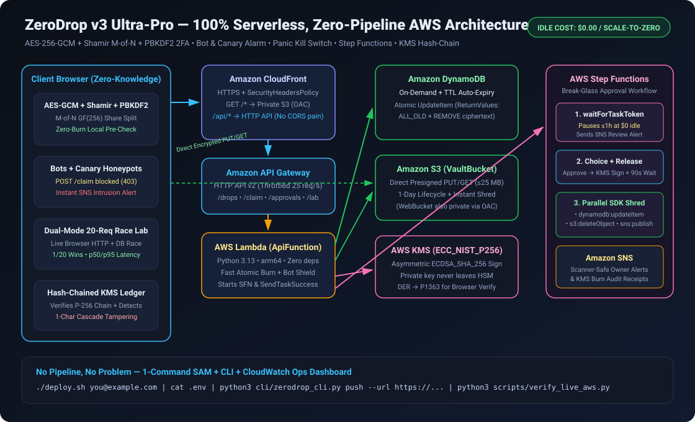

# ZeroDrop v4.0 APEX: Zero-Knowledge, Shamir-Quorum, Live-SOC & Panic-Shreddable Secret Escrow (Zero Pipelines, Zero Servers)

> **TL;DR:** Ever pasted an `.env` file into Slack and regretted it—or shared a one-time secret link only for Slack's link-preview crawler to burn it, or pasted a link in the wrong channel? **ZeroDrop v4.0 APEX** is a 100% serverless, zero-knowledge burn-after-reading, Shamir M-of-N quorum, live zero-scan SOC, instant kill-switch & break-glass secret escrow built with **AWS SAM** (`CloudFront`, `S3`, `API Gateway HTTP API`, `Lambda`, `Step Functions`, `DynamoDB`, `KMS`, `SNS`, `CloudWatch`). Zero servers, zero containers, zero CI/CD pipelines, and **$0.00 idle compute cost**.

---

## 1. The Problem: Why Existing One-Time Secret Links Fail in Real Engineering Teams

Every developer eventually shares a database password, webhook secret, `.env` file, or temporary `kubeconfig` over Slack, WhatsApp, or email. Even when teams use standard "one-time secret" tools, four real-world failures occur:

1. **Preview Bots Cry Wolf & Burn Your Secret:** Slackbot, WhatsApp, Discordbot, and corporate email scanners (`SafeLinks`) automatically fetch shared URLs to render link previews—burning naive one-time links before a human ever clicks them.
2. **Server-Side Encryption Keys:** Most secret-sharing apps receive plaintext over HTTPS and encrypt it on their backend—meaning API logs, memory dumps, or the cloud operator technically saw your secret.
3. **TOCTOU Concurrency Races & Missing Break-Glass Approval:** Under a naive `GetItem -> Delete` database check, 20 simultaneous requests can all read the secret before the first write finishes. And for high-risk secrets, there is no human approval pause before unlocking.
4. **No Cryptographic Proof, Preflight Guardrails, or Live SOC Visibility:** Once a secret is burned or denied, teams have no tamper-evident, independently verifiable proof of lifecycle—nor shoulder-surfing auto-wipe or zero-scan real-time SOC counters.

---

## 2. How ZeroDrop v4.0 APEX Solves It

1. **True Zero-Knowledge Browser Crypto (`AES-256-GCM`) + Client Preflight Scanner + Shamir `M-of-N` Quorum (`GF(256)`) + Optional 2FA Passphrase:**
   * Secrets (and files up to 25 MB) are scanned locally for AWS keys, PEM private keys, Stripe tokens, DB URIs, and Shannon entropy **in-browser before encryption** (with 1-click guardrail elevation), then encrypted inside the browser or CLI (`cli/zerodrop_cli.py`).
   * Choose **2-of-3** or **3-of-5** Shamir Secret Sharing to split the 256-bit key across multiple engineers (`#d=...&s=1-2-3:...`)—any 1 share reveals zero bits of information. Optional **2FA Passphrase** verifies `passphrase_check` locally **before calling `/claim`**, so typos never burn secrets!
   * On unlock, `.env` files render as **per-key masked rows** with individual reveal/copy buttons and a **60-second automatic RAM/DOM screen wipe** against shoulder-surfing.
2. **Instant Owner Panic Kill Switch (`POST /api/drops/{id}/shred`):**
   * Pasted a drop in the wrong channel? Every creator receives a one-time `kill_token` (stored as SHA-256 hash only) that atomically scrubs DynamoDB ciphertext, deletes S3 blobs, halts active Step Functions executions (`states:StopExecution`), emits SNS, and appends a KMS-signed **`OWNER_PANIC_SHREDDED`** entry.
3. **Bot-Proof Static Edge + Canary Honeypot SNS + CloudWatch Alarm:**
   * Crawlers hitting the URL receive only a static HTML shell from **CloudFront + private S3 (OAC)**—never executing JS or seeing `#k=`/`#s=`. Direct `POST /claim` bot probes return `403 BOT_SHIELD_BLOCKED`.
   * Canary Honeypot drops emit structured JSON logs (`CANARY_TRIPWIRE`) triggering CloudWatch Logs Metric Filters (`ZeroDrop/Security`), a **CloudWatch Alarm (`CanaryTripwireAlarm`)**, and instant SNS alerts.
4. **Two Serverless Unlock Modes:**
   * **⚡ Fast Atomic Burn:** Single atomic **DynamoDB `UpdateItem`** (`ConditionExpression`, `ReturnValues: "ALL_OLD"`, `REMOVE ciphertext_b64`). Strictly 1 of 20 simultaneous callers wins (`200 OK`); 19 get `410 Gone`.
   * **🛡️ Break-Glass Approval (AWS Step Functions `waitForTaskToken`):** Pauses execution up to 1 hour at `$0` idle compute while **Amazon SNS** sends a scanner-safe `#review=<token>` link. Owner `APPROVE` releases once, KMS-signs, waits 90s, and runs a **`Parallel` Direct AWS SDK Shred** (`dynamodb:updateItem`, `s3:deleteObject`, `sns:publish`).
5. **Hash-Chained KMS P-256 Audit Ledger + Offline Verifiable HTML Certificate:**
   * Every lifecycle event chains `prev_hash` (`0*64` genesis) and is signed by **AWS KMS (`ECC_NIST_P256`)** after ASN.1 DER → IEEE P1363 `(r || s)` conversion. Export a **self-contained `.html` cryptographic audit certificate** that verifies offline via WebCrypto even after `sam delete`.

---

## 3. Serverless Architecture & Observability



| AWS Service | Role in ZeroDrop v2 | Why Serverless Shines Here |
| --- | --- | --- |
| **Amazon CloudFront + Private S3 (`WebBucket` via OAC)** | Serves the single-file SPA over HTTPS (`SecurityHeadersPolicy`) and proxies `/api/*` to API Gateway on the **exact same origin** | Zero CORS headaches, global edge caching, private S3 bucket |
| **Amazon API Gateway (HTTP API v2)** | Public HTTPS API with route throttling (25 req/s, burst 50) | Scales to zero; protects Free Tier limits |
| **AWS Lambda (`ApiFunction` + `WorkflowTaskFunction`)** | Python 3.13 on `arm64` with **zero third-party pip dependencies** (`max_pool_connections=35`) | Instant cold start, ~1s `sam build`, zero servers |
| **Amazon DynamoDB (`DropsTable`)** | `PAY_PER_REQUEST` single-table store with `ttl_epoch` TTL auto-expiry | Atomic conditional writes eliminate race leaks; TTL cleans up free |
| **Amazon S3 (`VaultBucket`)** | Direct Presigned PUT/GET (≤25 MB) + token-authorized post-decrypt shred + 7-day Lifecycle backstop | Bypasses Lambda 6 MB payload limit |
| **AWS Step Functions (`ApprovalStateMachine`)** | Orchestrates `waitForTaskToken` pause, 90s grace `Wait`, `Choice`, `Catch`, and `Parallel` native SDK shred | Waits at $0 idle compute; direct SDK integrations avoid glue Lambdas |
| **AWS KMS (`ECC_NIST_P256`)** | Signs every hash-chained ledger entry inside AWS HSM | Private key never leaves HSM; verifiable in browser WebCrypto |
| **Amazon SNS (`AlertsTopic`)** | Delivers break-glass approvals, canary honeypot tripwires, and shred notifications | Zero mail server overhead |
| **Amazon CloudWatch (`LogGroups` + `ZeroDropOpsDashboard`)** | 14-day retention logs + pre-wired SAM dashboard for API status codes, Lambda p95 latency, DynamoDB latency & SFN counts | Production observability provisioned out-of-the-box |

---

## 4. Built-In Live Proof & Developer CLI

1. **Live Serverless Pipeline Bar:** Highlights the exact AWS flow (`WebCrypto → CloudFront → HTTP API → Lambda → DynamoDB / Step Functions → KMS → S3 Shred`) in real time as you click through the app.
2. **Dual-Mode 20-Request Race Lab (`Tab 4`):**
   * **Local 20-Thread Emulator Race:** Runs only against the in-memory local emulator to compare a synthetic naive check-then-burn with an atomic `ConditionExpression`; this lab endpoint is not exposed by the AWS deployment.
   * **Live Browser 20-Fetch HTTP Race:** When explicitly clicked, creates a real short-lived drop and fires **20 parallel browser `fetch()` requests** into `/api/drops/{id}/claim`, rendering the live `200` vs `410` responses. This is a real API load test, not part of the unit-test suite.
3. **Hash-Chained KMS Ledger & Cascade Tamper Demo (`Tab 5`):** Verifies every entry in the chain and proves 1-char tamper cascades across the ledger.
4. **Zero-Dependency CLI & Post-Deploy Benchmark:**
   * Pipe `.env` straight from stdin: `cat .env | python3 cli/zerodrop_cli.py push --url https://dxxx.cloudfront.net`
   * Benchmark live CloudFront deployments: `python3 scripts/verify_live_aws.py https://dxxx.cloudfront.net`

---

## 5. What Broke & Engineering Lessons Learned

1. **CloudFront `/api/*` + API Gateway `Host` Header 403 Trap:** Forwarding CloudFront's `Host` header to API Gateway causes `403`. Using AWS managed policy `AllViewerExceptHostHeader` (`b689b0a8-53d0-40ab-baf2-68738e2966ac`) fixes same-origin `/api/*` routing cleanly.
2. **AWS KMS DER vs. Browser WebCrypto IEEE P1363:** KMS returns ASN.1 DER signatures while `crypto.subtle.verify()` expects raw 64-byte `(r || s)`. A 15-line pure-Python `der_to_p1363()` converter bridges HSM signing to zero-dependency browser verification.
3. **Passphrase Typo Burn Trap:** If a recipient enters the wrong 2FA passphrase *after* claiming a one-time drop, the secret burns forever on a typo! Adding non-secret `iv_b64` + an encrypted `passphrase_check` sentinel lets the browser verify the passphrase **locally before sending `POST /claim`**.
4. **IAM `states:SendTaskSuccess` Scoping & Email Scanners:** Task tokens are opaque execution credentials requiring `Resource: "*"` in IAM, and routing email links to a static `#review=` screen with an explicit `POST` prevents SafeLinks scanners from auto-approving.

---

## 6. Deploy Your Own Copy in One Command

```bash
git clone <your-repo-url>
cd zerodrop
./deploy.sh your-email@example.com
python3 scripts/verify_live_aws.py https://<your-cloudfront-domain>
```
